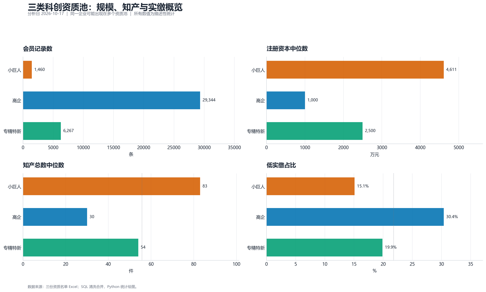

# 科创资质叠加与知识产权增量研究

> **可复现数据分析项目** ｜ 基于 62,182 条科创资质名单的 SQL + 统计匹配 + 可解释模型 + 评分函数


[完整报告](REPORT.md) · [方向 1 方法](docs/direction1_matching.md) · [方向 2 方法](docs/direction2_modeling.md) · [评分指南](docs/scoring_guide.md) · [方法总览](docs/methodology.md)



> [!IMPORTANT]
> **项目结论：** 现有数据不能支持“三个资质池互相独立”的强比较，但可以支持“资质叠加是否对应更高知产产出”的分层匹配研究。方向 1、方向 2 均已完成，并额外交付了一个**高企-like 企业资质叠加潜力评分函数**。该评分不是高新认定概率，也不是因果效应。

## 项目亮点

| 模块 | 完成内容 | 关键结果 |
|---|---|---|
| 数据治理 | SQL 三表合并、状态过滤、窗口去重、跨池识别 | 62,182 原始行 → 37,071 条资质×企业记录；覆盖 29,927 家企业 |
| 方向 1 | 资质组合定义 + 粗化精确匹配 + 池内最近邻匹配 | 小巨人/专精特新/三重叠加相对纯高企的知产差异均完成 Bootstrap 区间 |
| 方向 2 | 高企内部逻辑回归与增量特征验证 | 任一叠加模型 ROC-AUC 从 0.815 提升到 0.844 |
| 评分函数 | 保存三类目标模型、参考分布和 CLI 评分脚本 | 输出 `p_*`、`score_*`、`band_*`，并明确适用范围 |
| 工程化 | SQL + Python + GitHub Actions + 可复现报告 | 原始数据与企业级明细不入库，聚合结果和图谱公开 |

## 四个核心发现

1. **规模梯度清晰。** 注册资本、实缴资本、参保人数中位数均为小巨人 > 专精特新 > 高企。
2. **资质高度嵌套。** 小巨人中 99.73% 同时为高企，82.47% 同时为专精特新；三池不是独立总体。
3. **方向 1 显示知产增量。** 匹配后，三重叠加相对纯高企的知产总数中位数高 88.6% [75.0%, 104.7%]；高企+专精特新高 41.7%。
4. **方向 2 显示知产特征的增量解释力。** 加入专利、著作权和知产密度后，任一叠加模型 ROC-AUC 提升 0.029，95% CI [0.026, 0.032]。

## 方向 1：分层匹配


研究设计：

- 对照组：纯高企；
- 处理组：高企+专精特新、高企+小巨人、三重叠加；
- 先按规模、行业、区县、企业类型、年龄分档、资本四分位做粗化精确匹配；
- 再在精确格内用倾向得分和连续协变量做最近邻匹配；
- 以 Bootstrap 95% CI 报告知产中位数差异。

> [!NOTE]
> 匹配后最大 SMD 约 0.072；但三重叠加仅匹配了 761 / 1,202 对（63.3%），外推需谨慎。

## 方向 2：可解释模型


模型设定：

- 样本限定为高企，避免把高企与非高企混在一起；
- 目标：任一叠加、科技小巨人、专精特新；
- 基础特征：规模、资本、年龄、实缴率、行业、区县、企业类型；
- 增量特征：专利数、著作权数、知产密度；
- 5 折分层交叉验证，报告 ROC-AUC、PR-AUC、Brier、Top 10% 捕获率和 lift；
- 不做目标泄漏，不使用获评年份、资质标签或跨池标记作为特征。

### 主要结果

| 目标 | 基础 AUC | 基础+知产 AUC | ΔAUC [95% CI] |
|---|---:|---:|---:|
| 任一资质叠加 | 0.815 | 0.844 | +0.029 [+0.026, +0.032] |
| 科技小巨人 | 0.857 | 0.879 | +0.022 [+0.017, +0.026] |
| 专精特新 | 0.810 | 0.839 | +0.028 [+0.025, +0.032] |

特征组重要性排序中，**规模**和**专利**贡献最大，其次是年龄、知产密度和著作权。

## 评分函数

评分函数是方向 2 的工程化延伸，入口为：

```bash
python analysis/05_score_enterprise.py --input examples/candidate_template.csv --output outputs/scored_candidates.csv
```

输出字段：

- `p_any_stacking` / `score_any_stacking`
- `p_small_giant` / `score_small_giant`
- `p_specialized` / `score_specialized`
- `band_*`：按参考样本百分位划分为低 / 中 / 高

> [!WARNING]
> 训练集只有已经获得高企资质的企业，没有“申请但未通过”的负样本，因此**无法从现有数据计算高新认定概率**。这里的 `p_*` 是“在已观测高企样本中，与资质叠加相关的参考条件概率”；`score_*` 是参考样本内的相对潜力分。

## SQL-first 设计

项目把能在数据库里完成的逻辑尽量放在 SQL：

- `01_clean_merge.sql`：三表合并、字段标准化、状态过滤、信用代码窗口去重、跨池识别；
- `02_ip_by_scale.sql`：按资质池和规模档做窗口函数中位数与样本量聚合；
- `03_build_cohorts.sql`：企业级资质组合和互斥 cohort 构建；
- `04_create_analysis_dataset.sql`：高企分析母体、高频行业/区县/企业类型分组、资本四分位。

Python 主要负责 SQL 不擅长的部分：倾向得分与最近邻匹配、Bootstrap、模型训练与校准、可视化和评分接口。这样既保留 SQL 的可审计性，也避免把业务口径散落在多个 Python 脚本里。

## 仓库结构

```text
科创资质叠加与知识产权增量研究/
├─ README.md
├─ REPORT.md
├─ analysis/
│  ├─ 00_import_excel.py
│  ├─ 01_run_sql.py
│  ├─ 02_descriptive_profile.py
│  ├─ 03_direction1_matching.py
│  ├─ 04_direction2_modeling.py
│  ├─ 05_score_enterprise.py
│  └─ README.md
├─ sql/
│  ├─ 01_clean_merge.sql
│  ├─ 02_ip_by_scale.sql
│  ├─ 03_build_cohorts.sql
│  ├─ 04_create_analysis_dataset.sql
│  └─ README.md
├─ docs/
│  ├─ README.md
│  ├─ direction1_matching.md
│  ├─ direction2_modeling.md
│  ├─ scoring_guide.md
│  ├─ methodology.md
│  ├─ data_dictionary.md
│  └─ images/
├─ outputs/
│  ├─ tables/
│  ├─ models/
│  ├─ metrics.json
│  ├─ direction1_metrics.json
│  └─ direction2_metrics.json
├─ tools/
│  └─ preflight.py
├─ examples/
│  └─ candidate_template.csv
├─ data/
├─ requirements.txt
└─ run.ps1
```

## 快速开始

```bash
python -m venv .venv
# Windows: .venv\Scripts\activate
# macOS/Linux: source .venv/bin/activate
pip install -r requirements.txt

# 将三份 Excel 放入 data/raw/
python analysis/00_import_excel.py
python analysis/01_run_sql.py
python analysis/02_descriptive_profile.py
python analysis/03_direction1_matching.py
python analysis/04_direction2_modeling.py
```

## 数据与隐私

> [!CAUTION]
> 原始 Excel、`merged_clean.csv`、SQLite 数据库和带信用代码的评分输出不进入公开仓库。仓库仅发布聚合表、图表、SQL、模型、脚本和方法说明。评分模型的输入文件中如包含企业标识，请自行脱敏。

数据快照：最新核准日期 `2023-05-05`，最新成立日期 `2022-12-30`，最新获评年份 `2022`。所有结论均为静态快照下的描述性研究。

## 报告与产物

- [完整报告](REPORT.md)
- [方向 1 方法](docs/direction1_matching.md)
- [方向 2 方法](docs/direction2_modeling.md)
- [评分指南](docs/scoring_guide.md)
- [聚合表目录](outputs/tables/)
- [图表目录](docs/images/)

## License

仓库暂未指定开源许可证。公开前请根据数据授权、企业信息合规要求和团队政策补充许可证与数据使用声明。
