# 科创资质叠加与知识产权增量研究

> **静态数据快照分析报告**
> 分析日：2026-10-17 ｜ SQL：SQLite ｜ 统计建模：Python / pandas / scikit-learn / matplotlib

> [!IMPORTANT]
> 本报告的核心不是“比较三个独立资质池”，而是识别三池高度嵌套后，重构为“纯高企 / 高企+专精特新 / 高企+小巨人 / 三重叠加”的资质组合研究。方向 1 完成匹配与 Bootstrap 效应估计，方向 2 完成高企内部可解释分类模型和评分函数。

## 摘要

| 研究问题 | 完成情况 | 核心结果 |
|---|---|---|
| 三池能否直接独立比较？ | 已完成诊断 | 不能。小巨人中 99.73% 同时为高企，三池高度嵌套 |
| 资质叠加是否对应更高知产产出？ | 方向 1 已完成 | 匹配后三重叠加知产总数中位数高 88.6%，95% CI [75.0%, 104.7%] |
| 哪些企业特征与资质叠加相关？ | 方向 2 已完成 | 任一叠加模型 ROC-AUC=0.844，知产特征带来 ΔAUC=+0.029 |
| 能否做高新认定概率？ | 不能 | 训练样本只有已获高企企业，缺少“申请未通过”负样本 |
| 能否做资质叠加潜力评分？ | 已完成 | 输出三类目标概率、参考百分位分和低/中/高潜力带 |

## 1. 数据、口径与研究单元

### 1.1 样本漏斗

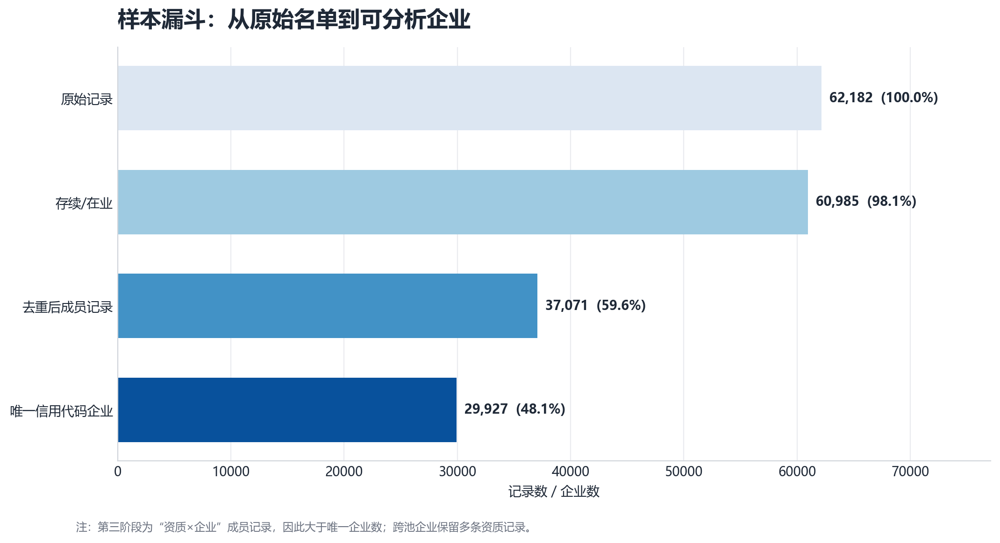

原始三表合计 **62,182** 行；登记状态过滤剔除 **1,197** 行；池内窗口去重删除 **23,914** 行；最终得到 **37,071** 条“资质×企业”成员记录，覆盖 **29,927** 家可识别信用代码企业。

| 资质池 | 成员记录 | 唯一企业 | 跨池企业 | 跨池占该池唯一企业 |
|---|---:|---:|---:|---:|
| 科技小巨人 | 1,460 | 1,460 | 1,458 | 99.9% |
| 高新技术企业 | 29,344 | 29,323 | 5,911 | 20.2% |
| 专精特新中小企业 | 6,267 | 6,259 | 5,659 | 90.4% |

### 1.2 数据质量

| 资质池 | 原始行 | 状态剔除 | 原始重复行 | 原始重复率 | 清洗后 n | 实缴资本缺失率 |
|---|---:|---:|---:|---:|---:|---:|
| 科技小巨人 | 1,643 | 12 | 171 | 10.4% | 1,460 | 18.8% |
| 高新技术企业 | 49,431 | 1,005 | 19,252 | 38.9% | 29,344 | 21.4% |
| 专精特新中小企业 | 11,108 | 180 | 4,713 | 42.4% | 6,267 | 13.3% |

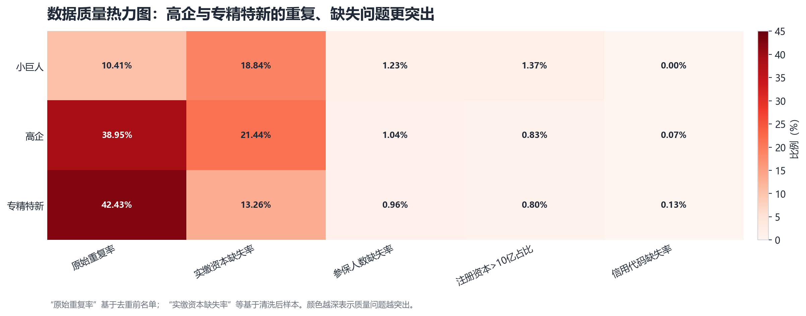

高企原始表实际 **49,431** 行，与背景预期“约 8,000 条”存在明显差异；高企和专精特新原始重复率分别约 **38.9%**、**42.4%**。因此，池内窗口去重不是可选项，而是保证后续口径可比的前提。

### 1.3 分析单元

项目最终分析单元有两种：

1. **资质×企业**：用于三池画像、重叠与数据质量；
2. **唯一信用代码企业**：用于方向 1 的匹配和方向 2 的模型，避免同一企业因跨池产生重复样本。

方向 1 和方向 2 均只使用可识别信用代码的高企样本，共 **29,323** 家。高企资质组合分布为：

| 资质组合 | 企业数 | 占比 |
|---|---:|---:|
| 纯高企 | 23,412 | 79.84% |
| 高企+专精特新 | 4,455 | 15.19% |
| 高企+小巨人 | 254 | 0.87% |
| 三重叠加 | 1,202 | 4.10% |

> [!NOTE]
> “高企+小巨人”不含三重叠加，“高企+专精特新”同样不含小巨人；“三重叠加”指同时具备三类资质。因此四组互斥，合计等于高企样本。

## 2. 资质嵌套：为什么必须重构研究设计

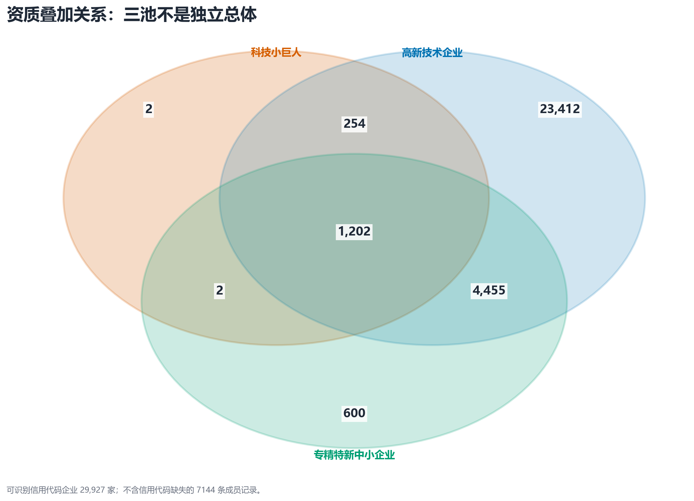

| 集合 A | 集合 B | 交集企业数 | 占 A | 占 B |
|---|---|---:|---:|---:|
| 科技小巨人 | 高新技术企业 | 1,456 | 99.7% | 5.0% |
| 科技小巨人 | 专精特新中小企业 | 1,204 | 82.5% | 19.2% |
| 高新技术企业 | 专精特新中小企业 | 5,657 | 19.3% | 90.4% |
| 小巨人+高企+专精特新 | 三重叠加 | 1,202 | 82.3% | — |

关键事实：

- 小巨人与高企交集 **1,456** 家，占小巨人的 **99.73%**；
- 小巨人与专精特新交集 **1,204** 家，占小巨人的 **82.47%**；
- 三重叠加 **1,202** 家。

如果直接对小巨人、高企、专精特新三组做均值比较，样本会重复计算，且“高企 vs 小巨人”本质上是“高企内部是否进一步获得小巨人”的嵌套比较，不是两个互斥总体。基于这一点，方向 1 和方向 2 都把研究范围限定在高企内部。

## 3. 基础画像：规模、知产与实缴

### 3.1 规模梯度

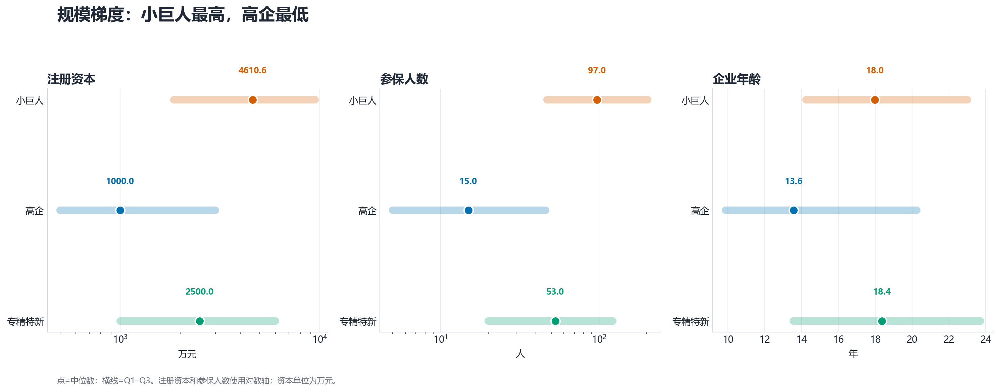

| 资质池 | n | 注册资本 中位数[Q1,Q3] | 参保人数 中位数[Q1,Q3] | 企业年龄 中位数[Q1,Q3] |
|---|---:|---:|---:|---:|
| 科技小巨人 | 1,460 | 4,610.6 [1,854.0, 9,458.9] | 97 [47, 203] | 17.98 [14.25, 23.00] |
| 高新技术企业 | 29,323 | 1,000.0 [500.0, 3,000.0] | 15 [5, 46] | 13.58 [9.87, 20.25] |
| 专精特新中小企业 | 6,263 | 2,500.0 [1,000.0, 6,000.0] | 53 [20, 122] | 18.37 [13.56, 23.72] |

注册资本、实缴资本和参保人数中位数均呈 **小巨人 > 专精特新 > 高企**。这说明在任何池间知产比较中，规模都是必须控制的混杂因素。

### 3.2 知产与实缴

| 资质池 | 专利数 中位数[Q1,Q3] | 著作权数 中位数[Q1,Q3] | 知产总数 中位数[Q1,Q3] | 知产密度中位数 |
|---|---:|---:|---:|---:|
| 科技小巨人 | 58 [27, 104] | 16 [3, 47] | 83.0 [57.8, 138.2] | 0.969 |
| 高新技术企业 | 11 [1, 31] | 14 [3, 24] | 30.0 [18.0, 48.0] | 1.818 |
| 专精特新中小企业 | 35 [11, 68] | 10 [0, 30] | 54.0 [35.0, 86.0] | 1.030 |

| 资质池 | 可计算 n | 实缴率 中位数[Q1,Q3] | 低实缴 n | 低实缴占比 | 实缴率缺失率 |
|---|---:|---:|---:|---:|---:|
| 科技小巨人 | 1,185 | 1.000 [0.560, 1.000] | 179 | 15.1% | 18.8% |
| 高新技术企业 | 23,052 | 0.810 [0.200, 1.000] | 7,007 | 30.4% | 21.4% |
| 专精特新中小企业 | 5,436 | 1.000 [0.400, 1.000] | 1,080 | 19.9% | 13.3% |

知产总量排序为小巨人 > 专精特新 > 高企，但知产密度排序为高企 > 专精特新 > 小巨人。这说明总量优势不能直接解释为效率优势，后续必须在控制规模后分析。

## 4. 方向 1：资质叠加的匹配分析

### 4.1 研究目标与假设

方向 1 要回答的问题不是“哪个池的均值更高”，而是：

> 在规模、行业、区县、企业类型、年龄和资本结构尽量相似的高企中，获得额外资质的企业是否具有更高的知产产出？

对应三个处理组：

- 高企 + 专精特新（不含小巨人）
- 高企 + 小巨人（不含专精特新）
- 三重叠加
- 对照组均为纯高企

分析是观察性、描述性的。即使匹配后存在差异，也不能直接解释为资质造成的因果效应。

### 4.2 匹配设计

匹配分两步：

1. **粗化精确匹配**：按参保人数档、行业门类、区县、企业类型、年龄分档、注册资本四分位组成精确格。
2. **格内最近邻匹配**：在精确格内，用倾向得分、企业年龄、log 参保人数、log 注册资本构成 1:1 无放回最近邻匹配，综合距离上限为 5.0 个标准化单位。

这样做的原因是：如果只做倾向得分匹配，行业/区县等分类变量仍可能不平衡；如果只做精确匹配，连续变量又会被过度粗化。两步匹配兼顾了可解释性和平衡性。

平衡性指标为标准化均值差 SMD：

```text
SMD = |mean_treated - mean_control| / sqrt((var_treated + var_control) / 2)
```

分类变量取各类别 SMD 的最大绝对值。通常 `SMD < 0.1` 视为可接受。

### 4.3 匹配结果与平衡性

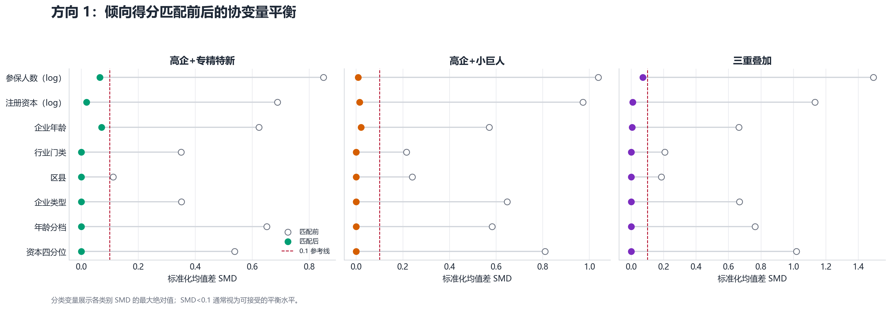

| 处理组 | 可用处理组 n | 成功匹配对 | 匹配率 | 匹配前最大 SMD | 匹配后最大 SMD |
|---|---:|---:|---:|---:|---:|
| 高企+专精特新 | 4,455 | 3,321 | 74.5% | 0.849 | 0.071 |
| 高企+小巨人 | 254 | 200 | 78.7% | 1.038 | 0.020 |
| 三重叠加 | 1,202 | 761 | 63.3% | 1.492 | 0.072 |

三个处理组匹配后最大 SMD 分别为：

- 高企+专精特新：**0.0710**
- 高企+小巨人：**0.0201**
- 三重叠加：**0.0719**

均低于 0.1，说明匹配后主要可观测协变量已较为平衡。但三重叠加仅匹配到 **761 / 1,202** 对（63.3%），因此结果对未被匹配的约 37% 企业外部有效性有限。

### 4.4 匹配后的整体知产效应

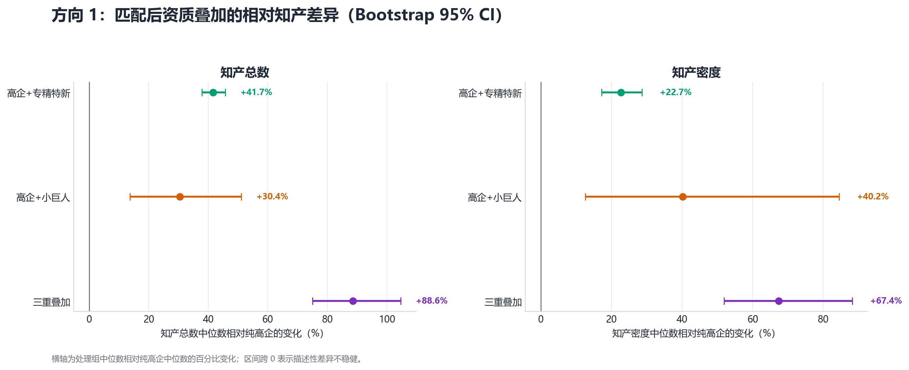

| 资质组合 | 指标 | 匹配对数 | 中位数相对变化 | Bootstrap 95% CI | 样本提示 |
|---|---|---:|---:|---:|---|
| 高企+专精特新 | 知产总数 | 3,321 | +41.7% | [+37.8%, +45.7%] |  |
| 高企+专精特新 | 专利数 | 3,321 | +77.8% | [+63.2%, +88.9%] |  |
| 高企+专精特新 | 著作权数 | 3,321 | +9.1% | [-8.4%, +20.0%] |  |
| 高企+专精特新 | 知产密度 | 3,179 | +22.7% | [+17.2%, +28.6%] |  |
| 高企+小巨人 | 知产总数 | 200 | +30.4% | [+13.7%, +51.1%] |  |
| 高企+小巨人 | 专利数 | 200 | +69.8% | [+21.7%, +126.3%] |  |
| 高企+小巨人 | 著作权数 | 200 | -7.7% | [-43.8%, +90.9%] |  |
| 高企+小巨人 | 知产密度 | 196 | +40.2% | [+12.7%, +84.5%] |  |
| 三重叠加 | 知产总数 | 761 | +88.6% | [+75.0%, +104.7%] |  |
| 三重叠加 | 专利数 | 761 | +136.0% | [+110.7%, +172.7%] |  |
| 三重叠加 | 著作权数 | 761 | +50.0% | [+8.3%, +87.5%] |  |
| 三重叠加 | 知产密度 | 749 | +67.4% | [+51.9%, +88.2%] |  |

核心结果：

- **高企+专精特新**：知产总数中位数比纯高企高 **41.7%**，区间 **[37.8%, 45.7%]**；专利高 **77.8%**，著作权差异不显著（区间跨 0）。
- **高企+小巨人**：知产总数高 **30.4%**，区间 **[13.7%, 51.1%]**；但匹配样本仅 **200** 对，结论应谨慎。
- **三重叠加**：知产总数高 **88.6%**，区间 **[75.0%, 104.7%]**；专利高 **136.0%**，著作权高 **50.0%**。三重叠加的知产优势最大。
- 知产密度也随资质叠加上升：高企+专精特新 **22.7%**，高企+小巨人 **40.2%**，三重叠加 **67.4%**，三个区间均不跨 0。

### 4.5 按规模档拆分

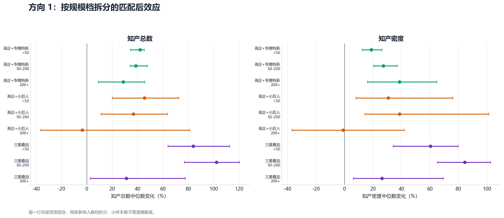

| 资质组合 | 规模档 | 匹配对数 | 知产总数变化 | 95% CI | 知产密度变化 |
|---|---:|---:|---:|---:|---:|
| 高企+专精特新 | <50 | 2,053 | +41.9% | [+34.4%, +45.2%] | +18.9% |
| 高企+专精特新 | 50-200 | 1,007 | +38.6% | [+34.1%, +47.6%] | +27.3% |
| 高企+专精特新 | 200+ | 251 | +28.8% | [+9.0%, +45.6%] | +38.6% |
| 高企+小巨人 | <50 | 89 | +45.5% | [+20.0%, +72.4%] | +30.8% |
| 高企+小巨人 | 50-200 | 76 | +36.7% | [+11.1%, +63.6%] | +38.6% |
| 高企+小巨人 | 200+ | 34 | -3.6% | [-36.4%, +81.0%] | -1.0% |
| 三重叠加 | <50 | 238 | +83.8% | [+63.9%, +112.5%] | +60.4% |
| 三重叠加 | 50-200 | 372 | +102.3% | [+76.8%, +120.2%] | +84.5% |
| 三重叠加 | 200+ | 149 | +31.2% | [+2.6%, +77.5%] | +26.3% |

分档结果说明：

- 高企+专精特新的知产总量优势在三个规模档内均为正，但幅度从 `<50` 档的 **+41.9%** 收窄至 `200+` 档的 **+28.8%**。
- 高企+小巨人在 `<50` 和 `50-200` 档为正，但 `200+` 档 n=34，区间跨 0，不能下“200+ 档仍有优势”的结论。
- 三重叠加在三个规模档均保持正效应；`200+` 档仍有 **+31.2%** 的知产总量差异，说明其优势并非完全由小微企业规模解释。
- 知产密度方面，高企+专精特新在 `200+` 档仍为 **+38.6%**，三重叠加为 **+26.3%**。

### 4.6 方向 1 结论

1. 匹配后仍能观察到资质叠加与更高知产产出相关，尤其是三重叠加和高企+专精特新，结果在多个规模档内保持一致。
2. 高企+小巨人的结果方向一致，但可用匹配样本仅 200 对；`200+` 档仅 34 对且区间跨 0，只能作为探索性证据。
3. 匹配设计控制了规模、行业、区县、类型、年龄和资本结构，但仍不能排除未观测混杂，也不能把差异解释为资质因果效应。
4. 由于匹配率不是 100%，方向 1 的结论更适用于“可匹配的高企样本”，而不是全部高企。

## 5. 方向 2：高企内部的资质叠加识别模型

### 5.1 样本与目标

方向 2 的研究母体严格限定为 **29,323** 家高企。定义三个二元目标：

| 目标 | 定义 | 正例数 | 正例率 |
|---|---|---:|---:|
| 任一资质叠加 | 高企+专精特新、高企+小巨人或三重叠加 | 5,911 | 20.16% |
| 科技小巨人 | 在高企基础上获得科技小巨人 | 1,456 | 4.97% |
| 专精特新 | 在高企基础上获得专精特新 | 5,657 | 19.29% |

> [!CAUTION]
> 这不是“高新认定模型”。所有样本都已获得高企资质，没有“申请但未通过”的负样本。模型只能回答“在已观测高企中，哪些特征与资质叠加相关”。

### 5.2 特征设计

**基础特征**

- 规模：log 参保人数、参保人数档
- 资本：log 注册资本
- 企业年龄
- 实缴率
- 行业门类
- 区县
- 企业类型

**增量特征**

- log 专利数
- log 著作权数
- log 知产密度

**防泄漏规则**

不使用 `qualification`、`cohort`、`cross_pool`、获评年份、企业名称、信用代码或任何由目标资质直接派生的字段。目标是预测/解释资质叠加，特征必须来自企业画像。

### 5.3 预处理与模型

- 数值变量：中位数插补 + 缺失指示 + 标准化。
- 分类变量：众数插补 + One-Hot，低频类别合并。
- 模型：L2 正则 Logistic Regression，`C=0.5`。
- 验证：5 折分层交叉验证，所有指标基于折外预测。
- 评估：ROC-AUC、PR-AUC、Brier score、Top 10% 捕获率、Top 10% lift。
- 模型比较：同一目标下比较“基础特征”与“基础+知产”，用配对 Bootstrap 估计 ΔAUC 的 95% 区间。

### 5.4 模型表现

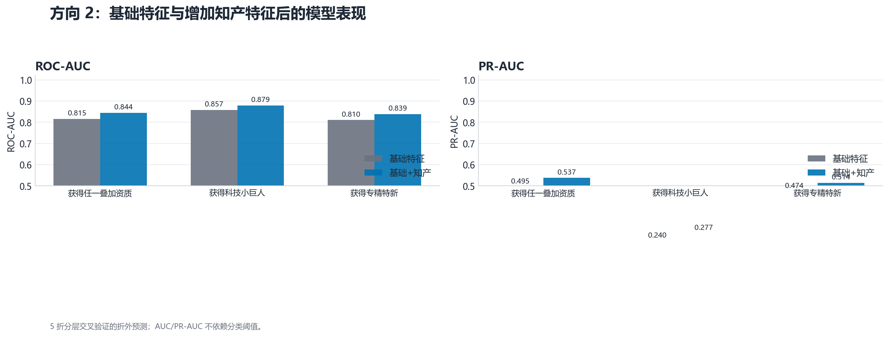

| 目标 | 模型 | 正例数 | 正例率 | ROC-AUC | PR-AUC | Top 10% 捕获率 | Top 10% lift |
|---|---|---:|---:|---:|---:|---:|---:|
| 任一资质叠加 | 基础特征 | 5,911 | 20.16% | 0.815 | 0.495 | 27.4% | 2.74 |
| 任一资质叠加 | 基础+知产 | 5,911 | 20.16% | 0.844 | 0.537 | 30.7% | 3.07 |
| 科技小巨人 | 基础特征 | 1,456 | 4.97% | 0.857 | 0.240 | 47.4% | 4.74 |
| 科技小巨人 | 基础+知产 | 1,456 | 4.97% | 0.879 | 0.277 | 54.8% | 5.48 |
| 专精特新 | 基础特征 | 5,657 | 19.29% | 0.810 | 0.474 | 27.3% | 2.73 |
| 专精特新 | 基础+知产 | 5,657 | 19.29% | 0.839 | 0.514 | 30.9% | 3.09 |

| 目标 | 基础 AUC | 基础+知产 AUC | ΔAUC | Bootstrap 95% CI |
|---|---:|---:|---:|---:|
| 任一资质叠加 | 0.815 | 0.844 | +0.029 | [+0.026, +0.032] |
| 科技小巨人 | 0.857 | 0.879 | +0.022 | [+0.017, +0.026] |
| 专精特新 | 0.810 | 0.839 | +0.028 | [+0.025, +0.032] |

任一资质叠加模型的 ROC-AUC 为 **0.844**，PR-AUC 为 **0.537**；加入知产特征后 ΔAUC 为 **+0.029**，95% CI **[+0.026, +0.032]**，增量解释力存在且区间不跨 0。

Top 10% 捕获率为 **30.7%**，lift 为 **3.07**：在模型给出的最高 10% 得分企业中，正例密度约为总体正例率的 3 倍。

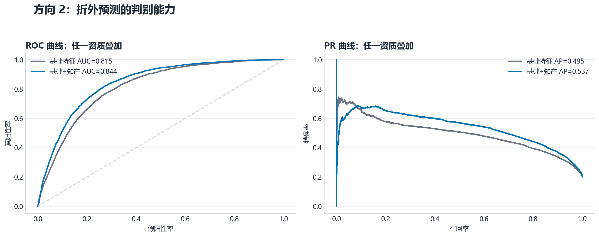

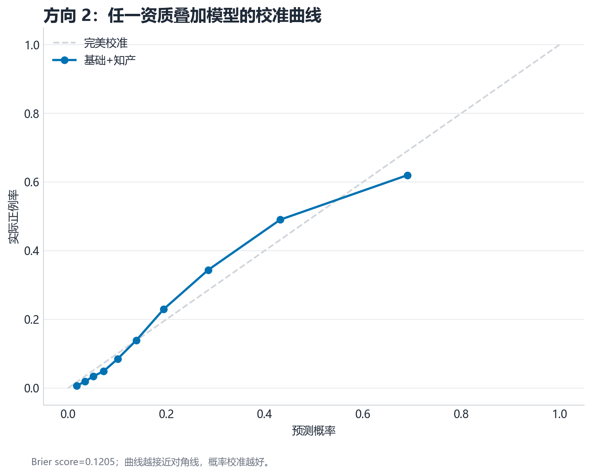

### 5.5 特征重要性

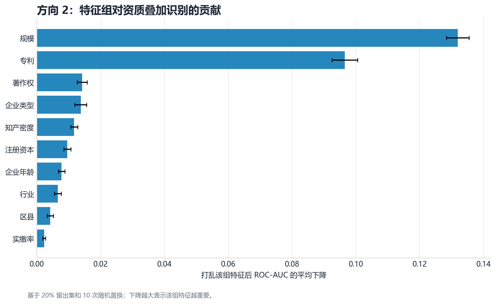

| 特征组 | 打乱后 AUC 平均下降 | 标准差 |
|---|---:|---:|
| 规模 | 0.1319 | 0.0036 |
| 专利 | 0.0965 | 0.0040 |
| 著作权 | 0.0142 | 0.0016 |
| 企业类型 | 0.0138 | 0.0018 |
| 知产密度 | 0.0117 | 0.0011 |
| 注册资本 | 0.0096 | 0.0011 |
| 企业年龄 | 0.0078 | 0.0010 |
| 行业 | 0.0066 | 0.0011 |
| 区县 | 0.0042 | 0.0010 |
| 实缴率 | 0.0023 | 0.0005 |

结果解读：

- **规模**是最重要的特征组，说明资质叠加与企业体量高度相关。
- **专利**是第二重要的特征组，支持“知产不是唯一因素，但具有独立增量信息”的判断。
- 企业年龄、知产密度、著作权、注册资本也有贡献，但强度低于规模和专利。
- 实缴率的增量贡献较小，与前面实缴率缺失较高、描述性差异有限的结论一致。

### 5.6 系数与解释边界

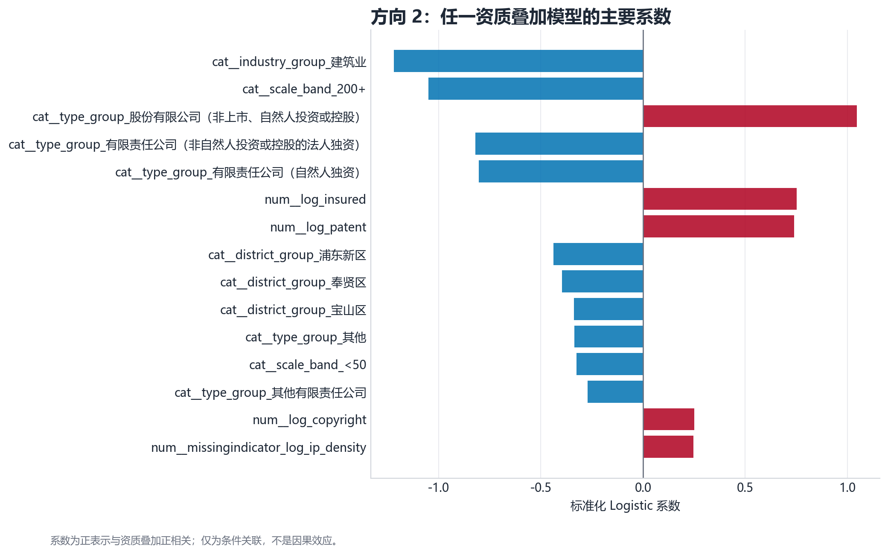

标准化系数只能解释为“控制其他特征后的条件关联”，不是因果效应。分类变量采用 One-Hot 编码，单个类别系数受参照组影响，因此报告更强调特征组置换重要性，而不是对单个行业或区县系数做过度解读。

### 5.7 评分分层验证

| 预测得分十分位 | n | 平均预测概率 | 实际正例率 |
|---:|---:|---:|---:|
| 1 | 2,933 | 1.8% | 0.6% |
| 2 | 2,932 | 3.4% | 1.9% |
| 3 | 2,932 | 5.1% | 3.4% |
| 4 | 2,932 | 7.2% | 4.9% |
| 5 | 2,933 | 10.1% | 8.5% |
| 6 | 2,932 | 13.9% | 13.9% |
| 7 | 2,932 | 19.4% | 23.0% |
| 8 | 2,932 | 28.5% | 34.4% |
| 9 | 2,932 | 43.2% | 49.0% |
| 10 | 2,933 | 69.0% | 62.0% |

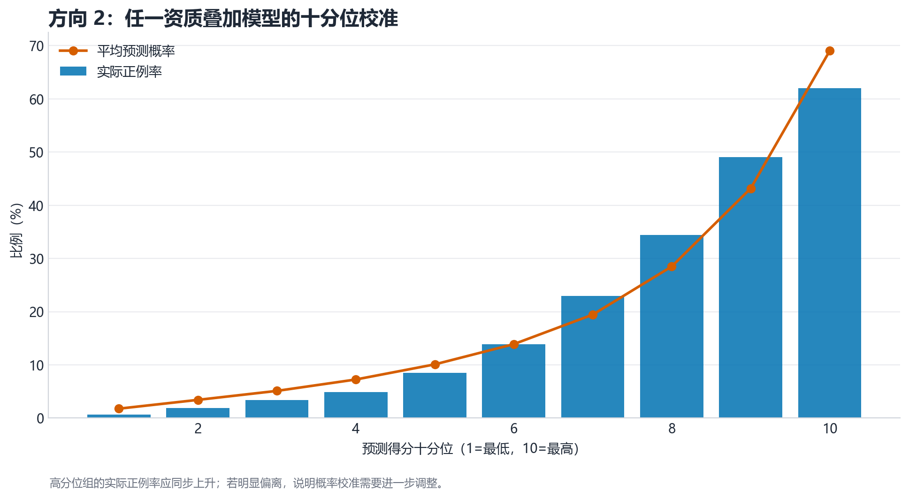

最高十分位的平均预测概率约为 **69.0%**，实际正例率为 **62.0%**；最低十分位实际正例率为 **0.6%**。排序和校准方向一致，说明评分具有可解释的相对区分能力。

### 5.8 方向 2 结论

1. 高企内部确实存在可识别的资质叠加画像：规模、专利、年龄、知产密度和著作权与资质叠加相关。
2. 知产特征在基础特征之上提供稳定增量：任一叠加 ΔAUC=+0.029，小巨人 ΔAUC=+0.022，专精特新 ΔAUC=+0.028。
3. 模型表现属于“中等偏上”的可解释模型水平，足以支持业务画像和评分原型，不足以支持高企认定预测或因果政策评估。
4. 由于缺少申请未通过样本、资质有效期和面板数据，模型应定位为 **资质叠加潜力识别**，而不是资格认定模型。

## 6. 评分函数：资质叠加潜力分

### 6.1 能做什么、不能做什么

| 问题 | 是否可做 | 原因 |
|---|---|---|
| 给高企-like 企业打“资质叠加潜力分” | ✅ 可以做 | 有 29,323 家高企样本和三个已定义目标 |
| 输出“获得高新资质的概率” | ❌ 不能做 | 训练集全部已是高企，没有申请失败样本 |
| 输出“获得小巨人/专精特新的概率” | ⚠️ 参考条件概率 | 只在已观测高企样本内定义，不是行政认定概率 |
| 用评分决定企业是否真的会获评 | ❌ 不应做 | 缺少政策阈值、申报材料、审核结果和有效期 |

因此本项目把评分命名为：

- `p_*`：参考条件概率；
- `score_*`：基于参考样本分布的 0–100 相对潜力分；
- `band_*`：低 / 中 / 高潜力带。

### 6.2 评分规则

评分脚本使用方向 2 保存的三个完整模型：

```bash
python analysis/05_score_enterprise.py \
  --input examples/candidate_template.csv \
  --output outputs/scored_candidates.csv
```

输出列：

| 列名 | 含义 |
|---|---|
| `p_any_stacking` | 任一叠加资质的参考条件概率 |
| `score_any_stacking` | 参考样本内 0–100 百分位潜力分 |
| `band_any_stacking` | <50 低、50–80 中、≥80 高 |
| `p_small_giant` | 科技小巨人参考条件概率 |
| `score_small_giant` | 科技小巨人潜力分 |
| `p_specialized` | 专精特新参考条件概率 |
| `score_specialized` | 专精特新潜力分 |
| `scope_note` | 适用范围与解释警告 |

输入字段如下：

| 字段 | 必填 | 说明 |
|---|---|---|
| credit_code | 否 | 企业标识，可用于回填结果 |
| insured_count | 建议 | 参保人数；缺失时模型使用中位数和缺失指示 |
| registered_capital_wan | 建议 | 注册资本，万元 |
| paid_in_capital_wan | 否 | 实缴资本，万元；可用于计算实缴率 |
| paid_in_rate | 否 | 实缴率；缺失时可由实缴/注册资本计算 |
| establishment_date | 否 | 成立日期 YYYY-MM-DD；用于计算企业年龄 |
| enterprise_age | 建议 | 企业年龄；缺失时可由成立日期计算 |
| patent_count | 建议 | 专利数 |
| copyright_count | 建议 | 著作权数 |
| ip_density | 否 | 知产密度；缺失时可由知产总数/参保人数计算 |
| industry_category | 建议 | 国标行业门类 |
| district | 建议 | 所在区县 |
| enterprise_type | 建议 | 企业（机构）类型 |
| scale_band | 否 | 规模分档；缺失时按参保人数自动生成 |

### 6.3 推荐使用方式

1. 只在已具备高企基础的企业池中使用。
2. 把评分作为筛排序工具，而不是资格判断工具。
3. 高分企业可用于优先补充知产布局、资质材料准备和政策辅导。
4. 低分企业不代表没有机会，只代表其当前画像与已观测叠加企业差异较大。
5. 任何对外沟通都应说明“参考条件概率”和“非认定概率”。

> [!IMPORTANT]
> `score_any_stacking` 不是“进入高新项目的概率”。由于缺少非高企和申请失败样本，任何声称可计算“高新通过概率”的做法都超出了数据支持范围。

## 7. 综合可行性判断

| 任务 | 可行性 | 依据 |
|---|---|---|
| 数据清洗与实体去重 | ✅ 已完成 | SQL 窗口函数和跨池检测已跑通 |
| 三池画像与规模梯度 | ✅ 已完成 | 规模、知产、实缴均有聚合表和图 |
| 资质叠加匹配分析 | ✅ 已完成 | 1:1 匹配、SMD 平衡、Bootstrap 区间 |
| 高企内部特征识别 | ✅ 已完成 | 5 折交叉验证、ROC/PR、校准曲线 |
| 资质叠加潜力评分 | ✅ 已完成 | 三个模型已保存，CLI 可对候选企业评分 |
| 高新认定概率 | ❌ 不可做 | 缺少未通过样本 |
| 资质因果效应 | ❌ 不可做 | 观察性数据、无政策时点和反事实 |
| 当前政策状态判断 | ❌ 不可做 | 数据无法更新，属于历史快照 |

## 8. 风险、限制与改进方向

### 8.1 数据质量风险

- 高企原始行数 49,431，与背景预期差异显著，需确认名单是当前有效、历史获评还是混合口径。
- 高企实缴资本缺失 6,292 条，缺失率 21.4%；评分模型对缺失做了中位数插补和缺失指示，但业务解释需谨慎。
- 原始重复率较高，窗口去重规则会影响最终样本；当前采用获评年份、频次和来源行号的确定性排序。
- 数据最新成立日期为 2022-12-30，年龄按 2026 分析日计算，时间口径偏大。

### 8.2 方法风险

- 方向 1 匹配后协变量平衡，但仍有未观测混杂，例如研发投入、营业收入、专利质量、政策辅导资源。
- 方向 1 三重叠加匹配率约 63.31%，高企+小巨人 78.74%；匹配样本不等同于全样本，外部有效性有限。
- 方向 2 的 AUC 属于可接受水平，但模型是横截面关联，不能做因果解释。
- 评分对训练分布外的企业外推能力有限；行业、规模和知产结构差异过大时，评分应降级为参考。
- 缺少专利类型、授权状态、软件著作权细分和研发费用，知产变量的信息含量仍不完整。

### 8.3 进一步改进

1. 补充高企申报通过/未通过样本，才能建立真正的认定概率模型。
2. 补充企业年度面板和资质生效/失效日期，才能做时间序列或政策评估。
3. 引入研发费用、营业收入、专利类型、研发人员占比等变量，提升特征完整度。
4. 对方向 1 结果做负对照、不同 caliper、不同匹配顺序和替换抽样敏感性分析。
5. 对评分模型做时间外验证和行业外验证，而不是仅依赖随机 5 折交叉验证。

## 9. 复现方式

```bash
python -m venv .venv
# Windows: .venv\Scripts\activate
# macOS/Linux: source .venv/bin/activate
pip install -r requirements.txt

python analysis/00_import_excel.py
python analysis/01_run_sql.py
python analysis/02_descriptive_profile.py
python analysis/03_direction1_matching.py
python analysis/04_direction2_modeling.py
```

评分：

```bash
python analysis/05_score_enterprise.py \
  --input examples/candidate_template.csv \
  --output outputs/scored_candidates.csv
```

## 10. 交付物索引

| 类别 | 文件 |
|---|---|
| 主报告 | `REPORT.md` |
| 方向 1 明细 | `outputs/tables/direction1_effects.csv` |
| 方向 1 平衡 | `outputs/tables/direction1_balance.csv` |
| 方向 2 表现 | `outputs/tables/direction2_model_performance.csv` |
| 方向 2 特征重要性 | `outputs/tables/direction2_feature_group_importance.csv` |
| 评分模型 | `outputs/models/direction2_*.joblib` |
| 评分元数据 | `outputs/models/score_metadata.json` |
| 评分输入模板 | `examples/candidate_template.csv` |
| 数据字典 | `docs/data_dictionary.md` |
| 方法总览 | `docs/methodology.md` |
| 方向 1 方法 | `docs/direction1_matching.md` |
| 方向 2 方法 | `docs/direction2_modeling.md` |
| 评分指南 | `docs/scoring_guide.md` |
